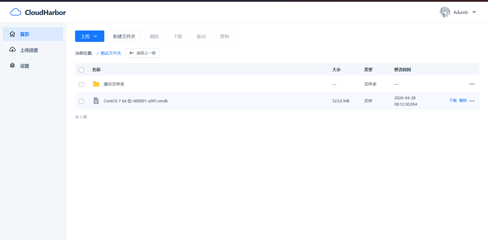
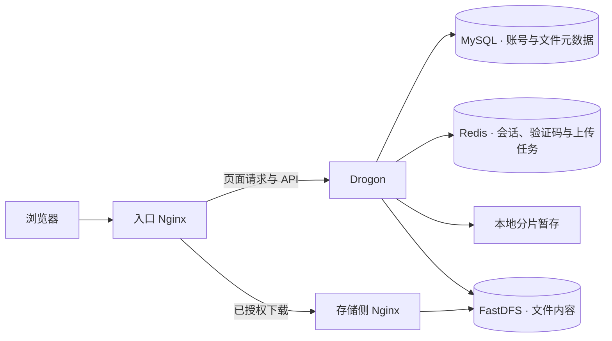
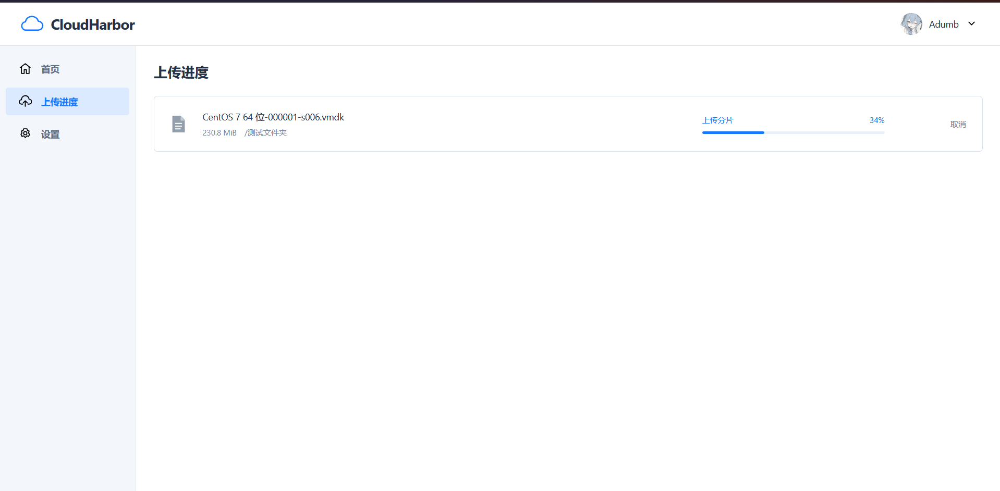
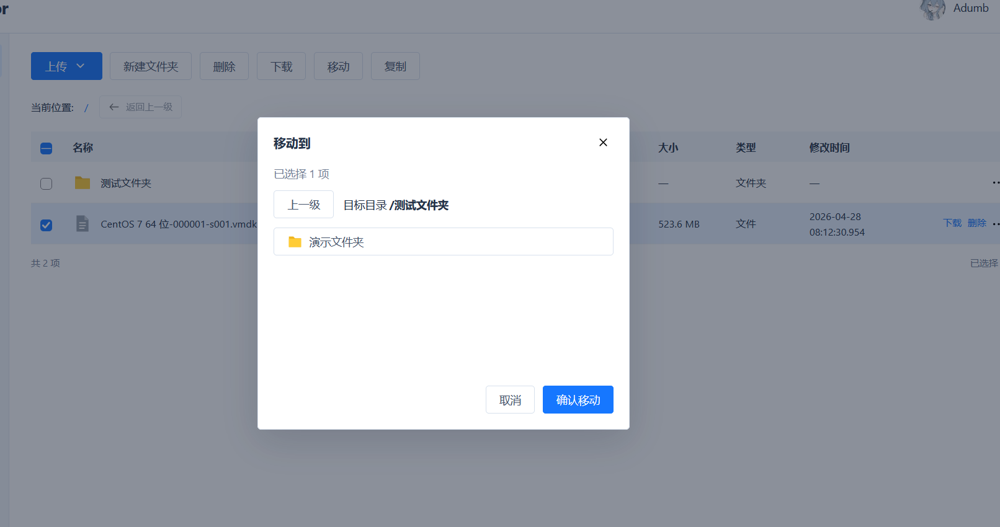
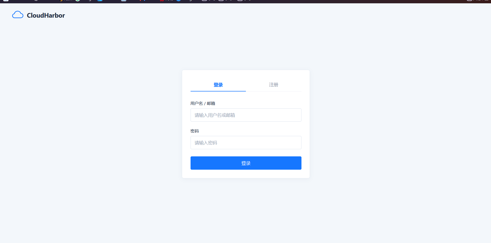

# CloudHarbor

CloudHarbor 是一个从零开发的 Web 网盘项目，用于学习和实践 C++ 后端开发、文件存储与服务部署。用户可以在浏览器中管理文件和目录、上传整个文件夹，以及恢复未完成的大文件上传。后端使用 C++20、Drogon 和协程，前端使用原生 HTML、CSS 和 JavaScript。



## 功能

- **账号管理**　邮箱验证码注册、登录和退出，支持修改用户名、邮箱、密码与头像。
- **文件管理**　浏览目录、新建文件夹、下载文件，以及移动、复制和删除文件与目录。
- **文件上传**　支持多文件和文件夹上传，可查看上传进度、取消任务以及恢复有效期内的分片上传。

## 关键实现

### 分片上传与失败恢复

分片写入服务端本地暂存目录，Redis 记录上传任务和已接收的分片编号。刷新页面后，浏览器能恢复上传任务列表。用户重新选择原文件后，可以继续上传缺失的分片。

合并时，后端在 MySQL 事务提交前将待确认的文件条目 ID 写入 Redis。完成请求重试时，后端可用该 ID 查询提交结果，避免重复创建文件条目。任务完成或取消后，暂存目录清理失败也可以在后续请求中重试。

源码：[上传流程](backend/src/modules/files/UploadService.cc) · [暂存与 Redis 状态](backend/src/modules/files/UploadTempStorage.cc) · [前端上传队列](frontend/js/features/upload.js)

### 文件内容去重

MySQL 的 `user` 记录账号和根目录，`file` 记录目录层级及文件元数据，`file_object` 记录 SHA-256、FastDFS 存储标识和引用计数。上传相同内容时可以复用已有存储对象，各条目仍保留自己的名称、位置和归属。复制文件也可以共享原对象。MySQL 触发器负责维护引用计数。

源码：[目录操作](backend/src/modules/files/FileService.cc) · [元数据与存储对象](backend/src/modules/files/FileRepository.cc)

### 会话认证与下载

浏览器通过 Cookie 携带会话标识，Drogon 从 Redis 核验登录状态，并检查当前用户是否有权访问文件。鉴权通过后，Drogon 返回 `X-Accel-Redirect`，由入口 Nginx 将下载交给存储侧 Nginx。

源码：[会话认证](backend/src/http/AuthFilter.cc) · [下载逻辑](backend/src/modules/files/FileService.cc) · [下载响应](backend/src/common/ApiResponse.cc)

## 系统架构



入口 Nginx 同时提供前端静态资源。后端通过 libcurl 对接 SMTP，使用 libsodium 处理密码散列和安全随机数。

### 主要第三方项目

- **Drogon** 提供 HTTP 路由和协程支持。 [官方仓库](https://github.com/drogonframework/drogon)
- **FastDFS** 持久化文件内容。后端调用客户端命令上传和删除存储对象。 [官方仓库](https://github.com/happyfish100/fastdfs)
- **FastDFS Nginx 模块** 由存储侧 Nginx 加载，通过 HTTP 提供文件下载。 [官方仓库](https://github.com/happyfish100/fastdfs-nginx-module)

## MySQL 表结构与初始化

| 表 | 字段 | 主要约束 |
| --- | --- | --- |
| `user` | `id`、`name`、`password`、`mail`、`root_id`、`avatar_path` | 用户名和邮箱分别唯一。密码列保存哈希。`root_id` 指向 `file.id`。 |
| `file` | `id`、`name`、`type`、`owner`、`father`、`size`、`last_modify`、`path` | `type` 区分文件和目录。`owner` 指向用户，`father` 指向父目录，`path` 指向存储对象。拥有同一用户和父目录的普通条目按名称判重。 |
| `file_object` | `id`、`storage_id`、`sha256`、`ref_count` | FastDFS 存储标识和非空 SHA-256 分别唯一。插入和删除文件条目时，触发器维护引用计数。 |

注册时，后端在同一个事务内创建用户、创建该用户的根目录，再回填 `user.root_id`。根目录的 `father` 为空，目录条目的 `path` 为空。

用有建库和建表权限的账号连接 MySQL 8.0，执行下方 SQL 初始化**全新数据库**。先建 `user` 和 `file_object`，再建依赖这两张表的 `file`，最后补上用户到根目录的外键和三个触发器。示例库名为 `CloudHarbor`，与应用配置样例一致。已有数据的实例需按现有表结构单独迁移。

<details>
<summary>展开完整建表 SQL</summary>

```sql
CREATE DATABASE CloudHarbor
  CHARACTER SET utf8mb4 COLLATE utf8mb4_0900_ai_ci;
USE CloudHarbor;

CREATE TABLE `user` (
  id BIGINT UNSIGNED NOT NULL AUTO_INCREMENT,
  name VARCHAR(50) NOT NULL,
  password VARCHAR(255) NOT NULL,
  mail VARCHAR(254) NOT NULL,
  root_id BIGINT UNSIGNED DEFAULT NULL,
  avatar_path VARCHAR(512) DEFAULT NULL,
  PRIMARY KEY (id),
  UNIQUE KEY uq_user_name (name),
  UNIQUE KEY uq_user_mail (mail)
) ENGINE=InnoDB DEFAULT CHARSET=utf8mb4 COLLATE=utf8mb4_0900_ai_ci;

CREATE TABLE file_object (
  id BIGINT UNSIGNED NOT NULL AUTO_INCREMENT,
  storage_id VARCHAR(512) CHARACTER SET utf8mb4 COLLATE utf8mb4_0900_bin NOT NULL,
  sha256 BINARY(32) DEFAULT NULL,
  ref_count BIGINT UNSIGNED NOT NULL DEFAULT 0,
  PRIMARY KEY (id),
  UNIQUE KEY uq_file_object_storage (storage_id),
  UNIQUE KEY uq_file_object_sha256 (sha256)
) ENGINE=InnoDB DEFAULT CHARSET=utf8mb4 COLLATE=utf8mb4_0900_ai_ci;

CREATE TABLE `file` (
  id BIGINT UNSIGNED NOT NULL AUTO_INCREMENT,
  name VARCHAR(255) NOT NULL,
  type ENUM('file', 'folder') NOT NULL,
  owner BIGINT UNSIGNED NOT NULL,
  father BIGINT UNSIGNED DEFAULT NULL,
  size BIGINT UNSIGNED DEFAULT NULL,
  last_modify DATETIME(3) DEFAULT NULL,
  path VARCHAR(512) CHARACTER SET utf8mb4 COLLATE utf8mb4_0900_bin DEFAULT NULL,
  PRIMARY KEY (id),
  UNIQUE KEY uq_file_name (name, father, owner),
  CONSTRAINT fk_file_owner FOREIGN KEY (owner) REFERENCES `user` (id),
  CONSTRAINT fk_file_parent FOREIGN KEY (father) REFERENCES `file` (id),
  CONSTRAINT fk_file_object_path FOREIGN KEY (path)
    REFERENCES file_object (storage_id) ON DELETE RESTRICT ON UPDATE RESTRICT
) ENGINE=InnoDB DEFAULT CHARSET=utf8mb4 COLLATE=utf8mb4_0900_ai_ci;

ALTER TABLE `user`
  ADD CONSTRAINT fk_user_root FOREIGN KEY (root_id) REFERENCES `file` (id);

DELIMITER //

CREATE TRIGGER file_object_add_reference AFTER INSERT ON `file`
FOR EACH ROW
BEGIN
  IF NEW.path IS NOT NULL THEN
    UPDATE file_object SET ref_count = ref_count + 1
    WHERE storage_id = NEW.path;

    IF ROW_COUNT() <> 1 THEN
      SIGNAL SQLSTATE '45000' SET MESSAGE_TEXT = 'Storage object is unavailable';
    END IF;
  END IF;
END//

CREATE TRIGGER file_object_remove_reference AFTER DELETE ON `file`
FOR EACH ROW
BEGIN
  IF OLD.path IS NOT NULL THEN
    UPDATE file_object SET ref_count = ref_count - 1
    WHERE storage_id = OLD.path AND ref_count > 0;

    IF ROW_COUNT() <> 1 THEN
      SIGNAL SQLSTATE '45000' SET MESSAGE_TEXT = 'Storage reference count mismatch';
    END IF;
  END IF;
END//

CREATE TRIGGER file_object_keep_reference BEFORE UPDATE ON `file`
FOR EACH ROW
BEGIN
  IF NOT (OLD.path <=> NEW.path) THEN
    SIGNAL SQLSTATE '45000' SET MESSAGE_TEXT = 'File storage reference is immutable';
  END IF;
END//

DELIMITER ;
```

</details>

## 构建与部署

项目已部署在 Ubuntu 24.04（64 位）VPS 上，后端由 systemd 管理。C++ 后端使用 CMake 3.20+ 构建。

本地配置可以从 [配置样例](backend/conf/config.example.json) 开始。按上节初始化 MySQL 数据库，启动 Redis 和 FastDFS，并为应用设置 `FDFSCLIENTCONF`、`SMTP_USER` 和 `SMTP_PASS`。按实际环境配置 [Nginx](backend/script/nginx_conf/default) 的前端目录、监听地址和上游服务。

- [环境检查](backend/script/check-env.sh)
- [构建](backend/script/build.sh)
- [手动启动](backend/script/run.sh)

这三个脚本从 `backend/script/` 执行。

## 目录查询压测

在 Windows 客户端使用 Python 按固定速率请求 Ubuntu VPS 的入口 Nginx。客户端经本机代理访问，使用已登录会话查询固定目录。下表记录两轮各 60 秒、目标 40 请求/秒的结果，延迟为成功请求的客户端端到端耗时。预检和预热不计入统计。

| 目录条目数 | 成功请求 / 计划请求 | 客户端 P50 | 客户端 P95 | 客户端 P99 |
| ---: | ---: | ---: | ---: | ---: |
| 2 | 2,400 / 2,400 | 212 ms | 230 ms | 243 ms |
| 102 | 2,398 / 2,400 | 371 ms | 976 ms | 1.10 s |

两轮压测在不同时间执行。耗时从客户端计时，包含网络传输。服务端 Nginx 日志样本显示，目录查询的上游响应平均耗时约 5 ms。

## 界面预览

**上传进度**



**选择移动目标目录**



**登录**


